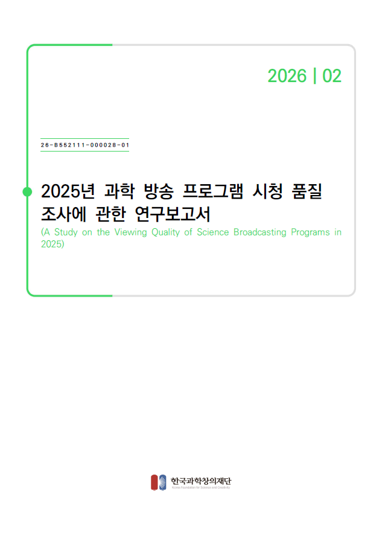

# 한국과학창의재단 과학방송 품질조사

**Science Broadcasting Quality Survey**

과학방송 콘텐츠의 품질을 조사·분석하고, 과학방송의 질적 향상과 과학문화 확산을 위한 기초자료를 제공합니다.

## 조사 개요

- **기관:** 한국과학창의재단 (KOSAC)
- **조사명:** 과학방송 품질조사
- **영문명:** Science Broadcasting Quality Survey
- **조사 목적:** 과학방송 콘텐츠의 품질 평가 및 개선 방향 도출
